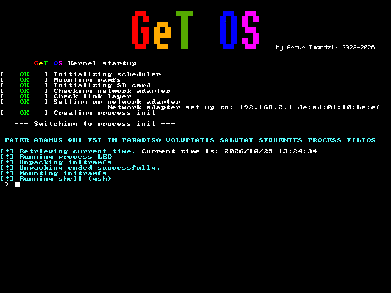
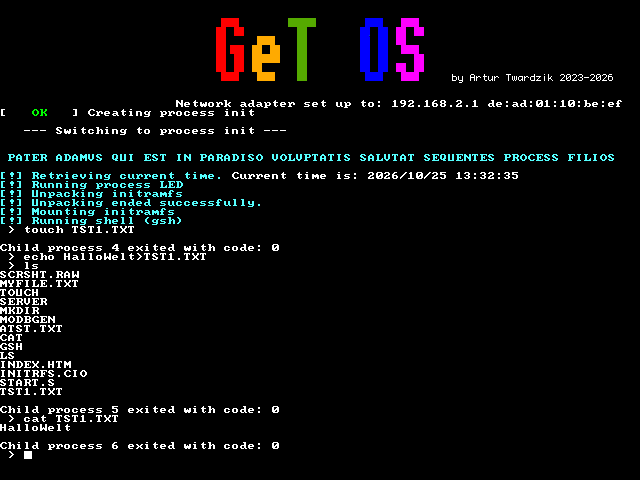
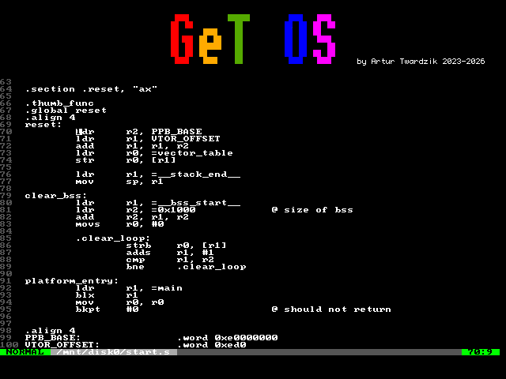

# Experimental Monolithic Kernel for RP2040/RP2350

-red?style=flat-square)


This project is a custom, monolithic operating system kernel designed
specifically for the Raspberry Pi Pico (RP2040) and the newer RP2350
microcontrollers. Written primarily in ARM Assembly to maximize low-level
control and serve as an educational deep-dive into OS architecture, it
implements core features like dynamic memory allocation, dynamic elf loader,
a custom libc, preemptive multitasking, and a POSIX-influenced syscall interface.

I also engineered a custom GeT Computer PCB, available
[here](https://github.com/atwardzik/GeT_Computer).

⚠️ Warning: Due to the kernel's complexity, writing new assembly code outside
of hardware drivers is currently not recommended, as much of the work includes operating on kernel structs, whose
structure and alignment may change in the development process. This is an
experimental project intended for learning and research.


## Features

| Feature                                       | Status | Notes                                                                                                                           |
|-----------------------------------------------|--------|---------------------------------------------------------------------------------------------------------------------------------|
| Dynamic memory allocation                     | ✅     | Linked-List allocator                                                                                                           |
| ELF executables                               | ✅     | Userspace programs can be compiled and linked into ordinary ELF files                                                           |
| Dynamic program loader                        | ✅     | Support for linking userspace programs against dynamic libraries – e.g. libc                                                    |
| Custom LIBC                                   | ✅     | For kernel and userspace                                                                                                        |
| Multitasking                                  | ✅     | Pre-emptive task scheduler                                                                                                      |
| POSIX-like syscalls                           | ✅     | [List of syscalls](https://github.com/atwardzik/os_kernel/blob/main/include/syscall_codes.h)                                    |
| Filesystem                                    | ✅     | Virtual File System interface and RAMFS                                                                                         |
| Networking                                    | ✅     | Raw sockets, TCP client and server                                                                                              |
| FAT16 SD Cards support                        | ✅     | Basic FAT16 support, currently for files on the root directory. It is recommended to store initramfs and system binaries there. |
| EXT2 support                                  | 🚧     | Planned                                                                                                                         |
| Multithreading                                | 🚧     | In progress                                                                                                                     |
| Custom C compiler and assembler for userspace | 🚧     | In progress                                                                                                                     |

## Drivers

| Driver                   | Status | Notes                                                         |
|--------------------------|--------|---------------------------------------------------------------|
| PS/2 keyboard driver     | ✅     | Both immediate and parallel interfaces (with shift-registers) |
| UART communication       | ✅     |                                                               |
| VGA driver (640x480)     | ✅     | Scaling up resolutions is in progress                         |
| SD card driver           | ✅     | Requires additional error checks and refactoring              |
| Ethernet (WIZnet W5100S) | ✅     | Raw sockets, TCP client and server                            |

## Future plans

- Extending shell and writing more user-space programs
- Introducing Rust into kernel
- Memory Protection
- PS2 mouse driver and a simple GUI
- Adding in-system simple debugging

## Building

### Prerequisites

- ARM GCC toolchain version 15.2.Rel1 (`arm-none-eabi-gcc`)
- clang version 22.1.4 – only for self-compiling userspace libc (needs `-fropi -frwpi` flags)
- CMake

### Build Instructions

```bash
git clone https://github.com/atwardzik/os_kernel.git
cd os_kernel
cmake -DCMAKE_EXPORT_COMMANDS=ON -DARCH_RP2350=1 -DSTANDALONE=1 -B build
cd build
make -j4
```

Depending on your needs you should choose `-DARCH_RP2040=1` or `-DARCH_RP2350=1`.
Also, if you want a standalone executable that can be put directly to SRAM by the debugger
pass `-DSTANDALONE=1`. Without this option the kernel is compiled into image that
will be loaded by the bootloader.

## Running

For using the OS put the kernel image (`bin/kernel.img`) into the `BOOT` partition of
your SD card. The partition must be formatted as FAT16. For the platform to run
the OS custom bootloader was created, available
[here](https://github.com/atwardzik/bootloader).

During development, the kernel is loaded directly into SRAM using a Raspberry Pi Debug Probe.

### Minimal Software Configuration

- Open On-Chip Debugger 0.12.0 (`openocd`)
- ARM GCC toolchain version 15.2.Rel1 (`arm-none-eabi-gdb`)
- Serial communication program (e.g. `screen`)

### Minimal Hardware Configuration

- RP2040 or RP2350 board
- Raspberry Pi Debug Probe
- SD card (optional, though without it no initramfs with shell would be loaded)

### Loading

On one terminal window run the on-chip debugger:

```bash
sudo openocd -s tcl -f interface/cmsis-dap.cfg -f target/rp2350.cfg -c "adapter speed 5000"
```

On another terminal window you can start the serial communication:

```bash
screen <uart_interface> 115200 -w 40 80 - U
```

Finally, on the last terminal window you can start running the OS with pre-configuration loaded from the `.gdbinit`
file:

```bash
arm-none-eabi-gdb bin/kernel_debug.elf
```

(do not forget to set breakpoints and run the OS from the gdb using `b` and `c` commands)

## Contributing

Issues and pull requests are welcome! Please open an issue before starting
major work.

Most of the features are currently unstable and require throughout testing and edge-case validation.
Some of the drivers currently only under specific conditions, so some work can be done almost everywhere.

There are also issues you can choose from. Some of them are marked
as "good first issue" – they require little to no knowledge of kernel internals,
but often are important for the stability of the system.

### Code Style

This project uses a `.clang-format` configuration file to enforce consistent
formatting.

Before submitting a pull request, please format your code using `clang-format`.

## Screenshots

Below some screenshots from the system runtime can be found. These are taken using Print Screen button on the keyboard
and are written into the SD card as raw vidram dump. In order to preview the files in .ppm
format [this script](scripts/image_retransform.py) must be used.

| Startup                        | File Creation            | vi clone             |
|--------------------------------|--------------------------|----------------------|
|  |  |  |

## License

Open-source and released under the BSD 3-Clause License. Feel free to use,
modify, and distribute the code in accordance with the terms specified in the
license.

Copyright (C) 2023-2026 Artur Twardzik
